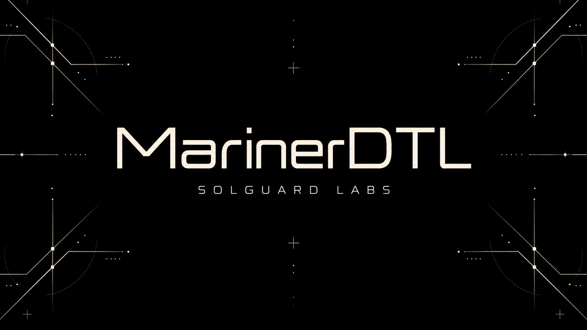
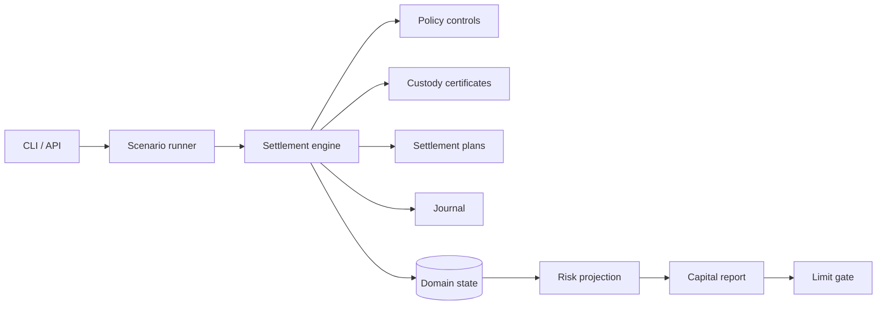
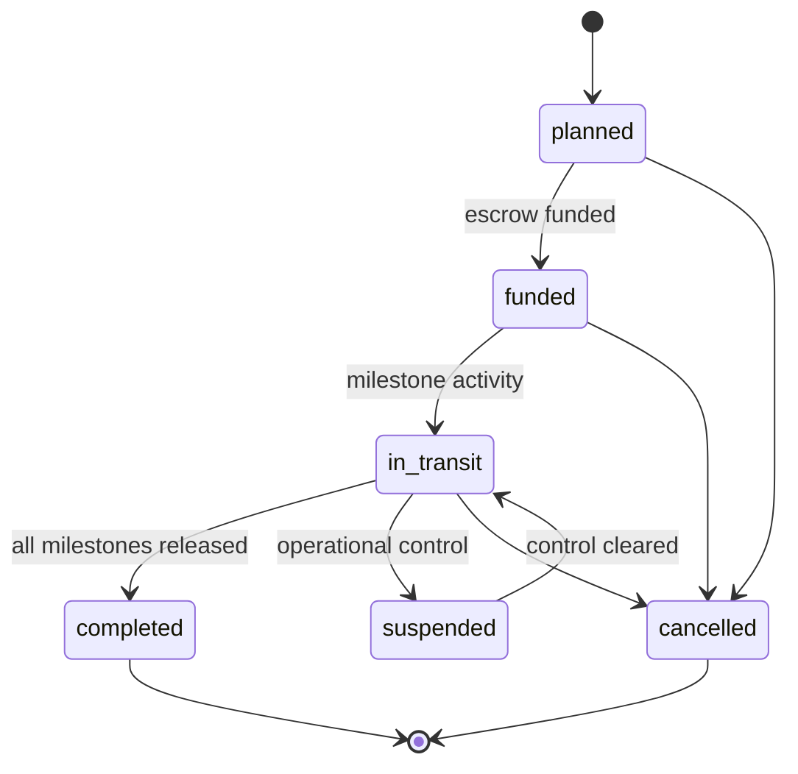
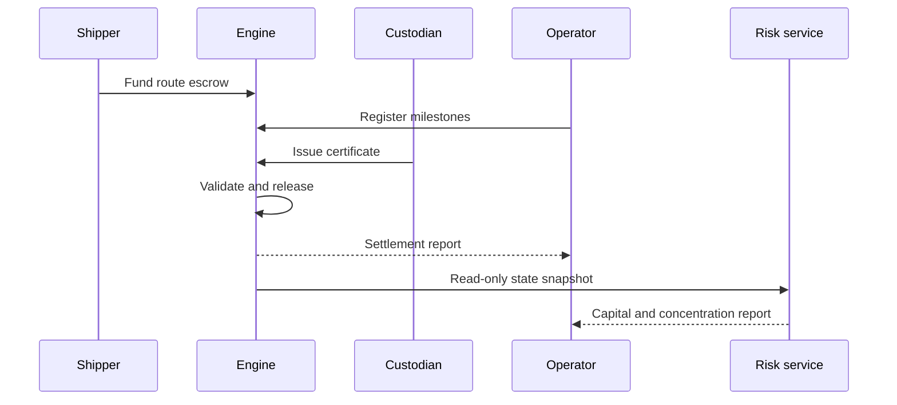

# MarinerDTL



[](https://github.com/SolguardLabs/MarinerDTL/actions/workflows/ci.yml)
[](https://github.com/SolguardLabs/MarinerDTL/actions/workflows/release-integrity.yml)
[](https://go.dev/)
[](https://github.com/SolguardLabs/MarinerDTL/releases/tag/v1.0.0)

MarinerDTL es un motor determinista de settlement marítimo para coordinar escrow, hitos logísticos, certificados de custodia, disputas operativas, penalizaciones y programas de rebate. El servicio está escrito en Go, expone una CLI y una API HTTP, y permite reproducir una operación completa a partir de escenarios JSON auditables.

La versión 1.0.0 incorpora además un modelo de riesgo de cartera que proyecta exposición por ruta, corredor, operador y custodio; calcula capital requerido bajo perfiles operativo y severo; y entrega una decisión de límites separada de la ejecución del settlement.

## Capacidades

- Ledger de doble movimiento para saldos disponibles, reservados, liquidados, penalizaciones y rebates.
- Escrow por ruta con hitos secuenciados y trazabilidad de fondos.
- Certificación de entrega por custodios designados.
- Disputas parciales, congelación de importes y resolución operacional.
- Cancelación económica con reparto determinista entre devolución y penalización.
- Rebate comercial condicionado por progreso y presupuesto.
- Análisis de capital con haircuts, reservas, concentración y cobertura.
- CLI, API HTTP, fixtures reproducibles y reportes JSON con digest SHA-256.

## Arquitectura







## Modelo económico

Para una ruta con hitos \(m_i\), MarinerDTL calcula el valor nominal y el progreso entregado como:

```text
V_route     = Σ amount(m_i)
V_delivered = Σ released(m_i)
progressBps = floor(V_delivered × 10 000 / V_route)
```

El escrow restante reconcilia liberaciones, devoluciones y penalizaciones. El modelo de riesgo agrega el valor no liquidado, valor congelado y rebate pendiente, y aplica cargos específicos por escenario:

```text
capital_required = escrow_haircut
                 + frozen_value_charge
                 + unsettled_value_charge
                 + rebate_reserve
                 + penalty_recovery_charge
                 + concentration_add_ons

target_capital = capital_required × minimum_coverage_bps / 10 000
```

Las fórmulas, supuestos y ejemplos completos están en [docs/modelo-economico.md](./docs/modelo-economico.md) y [docs/riesgo-y-capital.md](./docs/riesgo-y-capital.md).

## Inicio rápido

Requisitos: Go 1.22 o superior, Node.js 24 y npm 10 o superior.

```bash
npm ci
npm run build
npm test
```

Ejecutar un ciclo de liquidación:

```bash
bin/marinerdtl run tests/fixtures/release_cycle.json --pretty --events
```

Analizar su capital bajo el perfil operativo:

```bash
bin/marinerdtl risk tests/fixtures/escrow_funding.json --capital 250000
```

Aplicar el perfil severo:

```bash
bin/marinerdtl risk tests/fixtures/escrow_funding.json --capital 250000 --severe --json
```

Levantar la API local:

```bash
bin/marinerdtl serve --addr 127.0.0.1:8092
```

## API

| Método | Ruta                    | Propósito                          |
| ------ | ----------------------- | ---------------------------------- |
| `GET`  | `/healthz`              | Estado del servicio                |
| `POST` | `/v1/scenario/run`      | Ejecuta una operación determinista |
| `POST` | `/v1/scenario/validate` | Valida reglas y consistencia       |
| `POST` | `/v1/risk/analyze`      | Calcula exposición y capital       |

Ejemplo de análisis:

```json
{
  "scenario": {
    "name": "mediterranean-cycle",
    "assets": [],
    "accounts": [],
    "steps": []
  },
  "availableCapital": 250000,
  "profile": "severe"
}
```

Consulte [docs/integracion.md](./docs/integracion.md) para contratos, códigos HTTP y recomendaciones de idempotencia.

## Estructura

| Ruta             | Responsabilidad                                  |
| ---------------- | ------------------------------------------------ |
| `src/domain`     | Estado, entidades y proyecciones de reporte      |
| `src/engine`     | Casos de uso y coordinación transaccional        |
| `src/settlement` | Planes puros de progreso, disputa y settlement   |
| `src/ledger`     | Journal económico y movimientos                  |
| `src/custody`    | Certificados y autoridad de custodia             |
| `src/policy`     | Límites y parámetros económicos                  |
| `src/risk`       | Exposición, stress, capital y puertas de límites |
| `src/scenario`   | Carga y ejecución determinista de escenarios     |
| `src/api`        | Adaptador HTTP                                   |
| `tests`          | Fixtures y pruebas de integración TypeScript     |

## Validación

```bash
npm run ci
```

La puerta completa ejecuta `gofmt`, pruebas Go, `go vet`, build, comprobación TypeScript, pruebas de integración, Prettier, umbral de código, control terminológico e integridad de release. Los mismos controles se ejecutan en Linux y Windows.

## Documentación

- [Arquitectura](./docs/arquitectura.md)
- [Modelo económico](./docs/modelo-economico.md)
- [Riesgo y capital](./docs/riesgo-y-capital.md)
- [Operación](./docs/operacion.md)
- [Integración](./docs/integracion.md)
- [Política de seguridad](./SECURITY.md)
- [Contribución](./CONTRIBUTING.md)
- [Historial de cambios](./CHANGELOG.md)

## Licencia

Distribuido bajo la licencia MIT. Consulte [LICENSE](./LICENSE).
