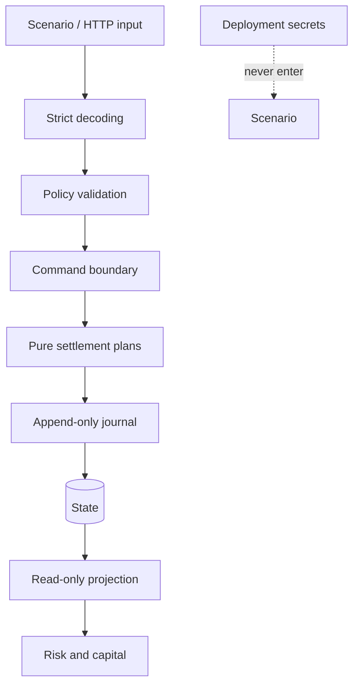
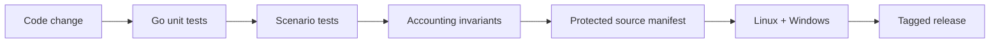

# Política de seguridad

MarinerDTL procesa reglas de settlement, custodia y capital. Los cambios sobre rutas económicas requieren revisión explícita, pruebas de reconciliación y evidencia reproducible antes de incorporarse a una versión.

## Versiones mantenidas

| Versión | Estado           | Mantenimiento                          |
| ------- | ---------------- | -------------------------------------- |
| 1.0.x   | Estable          | Correcciones de seguridad e integridad |
| < 1.0   | Fuera de soporte | Sin actualizaciones                    |

## Límites de confianza

## Invariantes de mayor criticidad

- Ningún saldo disponible, reservado o de escrow puede ser negativo.
- Un movimiento de salida debe tener contrapartida identificable en el journal.
- El valor de un hito no puede superarse mediante liberación, cancelación y penalización combinadas.
- Un certificado solo vincula el custodio y el hito declarados.
- El presupuesto reclamado de rebate no puede exceder el presupuesto configurado.
- Los informes de riesgo son proyecciones de solo lectura y no mutan el estado económico.
- Los importes usan enteros; no se aceptan operaciones con coma flotante.

## Controles de desarrollo

1. `go test ./...` valida lógica unitaria y cálculos de riesgo.
2. `go vet ./...` comprueba construcciones sospechosas del código Go.
3. Las pruebas TypeScript ejecutan el binario real contra fixtures JSON.
4. El workflow compara el manifiesto de fuentes económicas protegidas.
5. El control de release exige banner, documentación, versión y tag coherentes.
6. La matriz ejecuta los mismos contratos en Linux y Windows.

## Comunicación responsable

No publique detalles técnicos sensibles en un issue. Use el canal privado de seguridad de GitHub del repositorio e incluya:

- versión y commit afectados;
- componente y precondiciones;
- impacto económico u operativo observado;
- pasos mínimos de reproducción;
- resultado esperado y resultado obtenido;
- propuesta de contención, si existe.

Se acusará recibo, se verificará el alcance y se coordinará una corrección antes de cualquier comunicación pública.

## Despliegue

El servicio no incorpora gestión de identidad, almacenamiento persistente ni transporte TLS. Esas capacidades pertenecen a la plataforma que lo aloje. Toda exposición de la API debe situarse detrás de autenticación, autorización por rol, limitación de tasa, TLS y registro centralizado. Nunca deben enviarse secretos en escenarios, metadatos o eventos.
