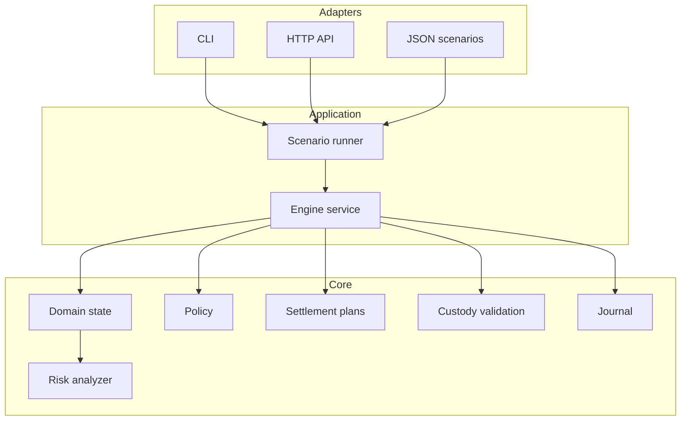
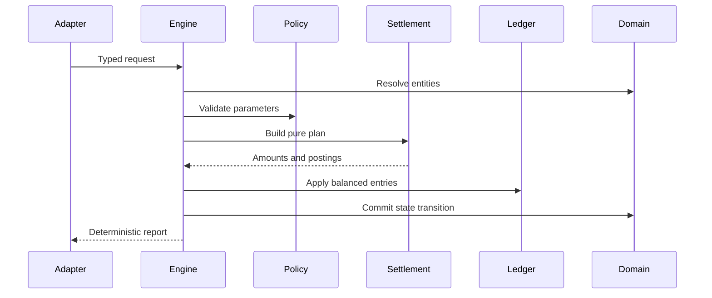

# Arquitectura de MarinerDTL

## Principios

MarinerDTL aplica cuatro límites deliberados: dominio sin dependencias de transporte, planes económicos puros antes de mutar estado, journal como evidencia de cada movimiento y análisis de riesgo de solo lectura. Esta separación permite revisar por separado admisión, cálculo, contabilización y exposición.

## Capas

### Dominio

`domain.State` mantiene activos, cuentas, rutas, hitos, certificados, disputas, métricas y eventos. Los métodos de consulta devuelven colecciones ordenadas para garantizar resultados reproducibles. `Clone` permite aislar una instantánea antes de una evaluación externa.

### Aplicación

`engine.Service` constituye el límite transaccional. Cada comando valida referencias, roles, política y solvencia; construye el plan correspondiente; aplica movimientos; actualiza entidades; y emite un evento.

### Settlement

Los paquetes de settlement calculan planes sin acceso a red ni almacenamiento. El resultado contiene importes explícitos que el motor puede validar y aplicar. Esto reduce el número de estados intermedios y facilita pruebas por tabla.

### Riesgo

`risk.ProjectState` transforma el estado en posiciones sin métodos de escritura. El analizador agrega dichas posiciones y genera un informe determinista. La puerta de límites consume el informe, pero nunca ejecuta instrucciones sobre el ledger.

## Flujo de un comando

Si falla una validación, no se debe aplicar ninguna mutación posterior. Las entradas del journal identifican ruta, hito, activo, origen, destino y motivo.

## Determinismo

- Los importes son `int64` no negativos encapsulados por `money.Amount`.
- Los ratios usan puntos básicos y redondeo entero explícito.
- Los mapas se ordenan antes de producir reportes.
- El runner no consulta red, reloj del sistema ni fuentes aleatorias.
- El digest de riesgo se calcula sobre JSON canónico generado por estructuras ordenadas.

## Extensión

Un nuevo adaptador debe traducir su entrada a requests tipados y delegar en el motor. Una nueva regla económica debe implementarse como cálculo puro, acompañarse de casos límite y documentar el redondeo. Una nueva métrica de riesgo debe añadirse a la proyección, al desglose de capital y a las pruebas de determinismo.
