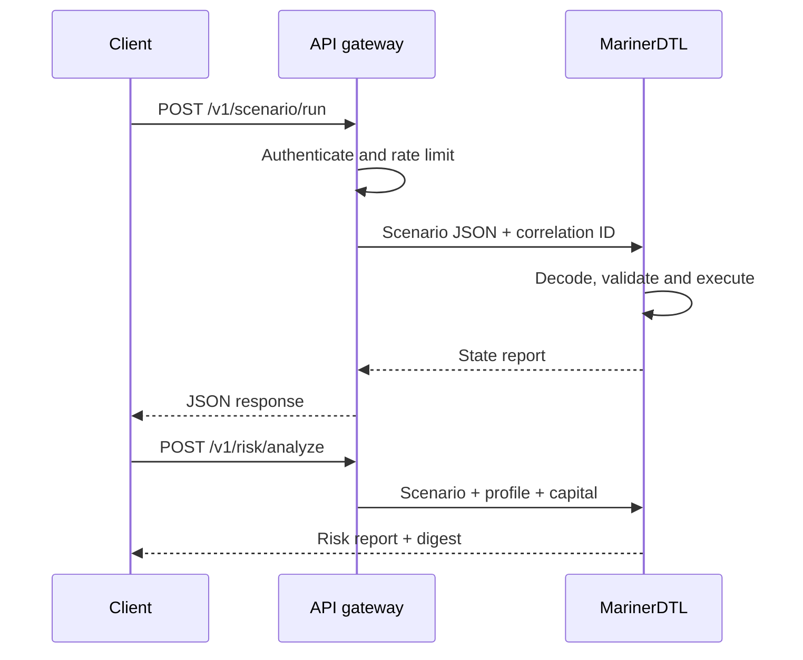

# Integración

## CLI

La CLI escribe resultados en `stdout` y errores en `stderr`. Un fallo devuelve código distinto de cero. Para integraciones automatizadas use `--json`; `--pretty` está orientado a inspección humana.

## HTTP



### Ejecutar un escenario

```http
POST /v1/scenario/run?events=false HTTP/1.1
Content-Type: application/json

{
  "name": "route-cycle",
  "assets": [],
  "accounts": [],
  "steps": []
}
```

Una entrada inválida produce `400` con `{ "error": "..." }`. Una ejecución válida produce `200` y un `StateReport`.

### Analizar riesgo

```http
POST /v1/risk/analyze HTTP/1.1
Content-Type: application/json

{
  "scenario": {
    "name": "route-cycle",
    "assets": [],
    "accounts": [],
    "steps": []
  },
  "availableCapital": 500000,
  "profile": "operating"
}
```

`profile` admite `operating` y `severe`; cualquier otro valor usa el perfil operativo. `availableCapital` debe ser un entero no negativo.

## Idempotencia

La ejecución completa de un mismo escenario con la misma versión produce el mismo reporte. El servicio no guarda resultados entre requests. Un gateway puede usar una clave de idempotencia para evitar procesamientos duplicados aguas arriba, pero debe asociarla también al hash del body y a la versión de MarinerDTL.

## Compatibilidad

Dentro de una versión mayor:

- los campos existentes no cambian de significado;
- pueden añadirse campos opcionales;
- los estados enumerados se documentan antes de incorporarse;
- los clientes deben ignorar campos desconocidos;
- los errores de entrada siguen usando HTTP `400`.

## Seguridad de transporte

La API escucha HTTP sin TLS y debe desplegarse detrás de un gateway. El gateway debe aportar TLS, autenticación, autorización, límites de tamaño, timeout, limitación de tasa y logs de acceso. No exponga directamente el puerto del proceso a una red no confiable.

## Ejemplo TypeScript

```ts
const response = await fetch("https://settlement.example/v1/risk/analyze", {
  method: "POST",
  headers: { "content-type": "application/json" },
  body: JSON.stringify({ scenario, availableCapital: 500_000, profile: "severe" }),
});

if (!response.ok) {
  throw new Error(`MarinerDTL returned ${response.status}`);
}

const report = await response.json();
console.log(report.digest, report.capital.coverageBps);
```
