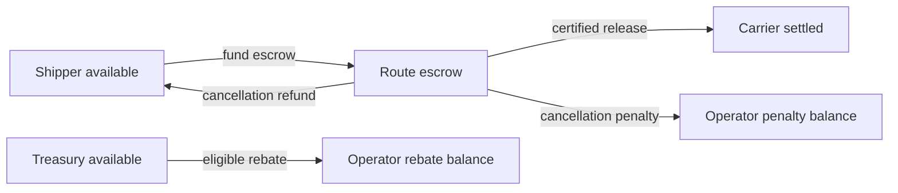

# Modelo económico

## Unidades

Todos los importes se expresan en la unidad mínima del activo. Para un activo de seis decimales, `1 000 000` representa una unidad. Los porcentajes se expresan en puntos básicos: `10 000 bps = 100 %`.

## Ciclo de fondos



Una ruta define un activo único. Al financiarla, el saldo del shipper pasa de disponible a reservado. Cada hito consume una parte del escrow cuando existe evidencia de entrega. Una cancelación divide el remanente del hito entre devolución y penalización.

## Reconciliación

Para un hito \(i\):

```text
remaining_i = amount_i - released_i - cancelled_i - penalty_i
```

La condición de validez es:

```text
0 <= released_i + cancelled_i + penalty_i <= amount_i
```

Para una ruta:

```text
gross_route = Σ amount_i
delivered_route = Σ released_i
cancelled_route = Σ cancelled_i
penalties_route = Σ penalty_i
progress_bps = floor(delivered_route × 10 000 / gross_route)
```

## Cancelación

Sea \(p\) la penalización en puntos básicos y \(r\) el remanente:

```text
penalty = floor(r × p / 10 000)
refund  = r - penalty
```

La resta final absorbe el residuo de redondeo, por lo que `refund + penalty == remaining` siempre se conserva.

### Ejemplo

Un hito de `8 000 000` tiene `2 000 000` ya liberados y una penalización de `750 bps`:

```text
remaining = 6 000 000
penalty   = 450 000
refund    = 5 550 000
```

## Rebate

El programa de rebate pertenece a una ruta, tiene presupuesto máximo, tasa y progreso mínimo. El importe económico se acota tanto por la base entregada como por el presupuesto aún disponible. El pago se debita de una cuenta de tesorería y se acredita al saldo de rebate designado.

```text
earned      = floor(delivered_value × rebate_bps / 10 000)
outstanding = max(rebate_budget - rebate_claimed, 0)
payable     = min(earned, outstanding)
```

## Journal

Cada movimiento conserva dos lados económicos. El agregado por activo debe reconciliar depósitos externos, fondos aún disponibles, escrow reservado, saldos liquidados, rebates y penalizaciones. Las métricas no sustituyen el journal; sirven para resumirlo.

## Límites numéricos

`money.Amount` rechaza negativos y detecta overflow en suma y multiplicación. Las operaciones con porcentajes multiplican antes de dividir, por lo que la política limita importes máximos. No se usan `float32` ni `float64` en cálculos monetarios.
