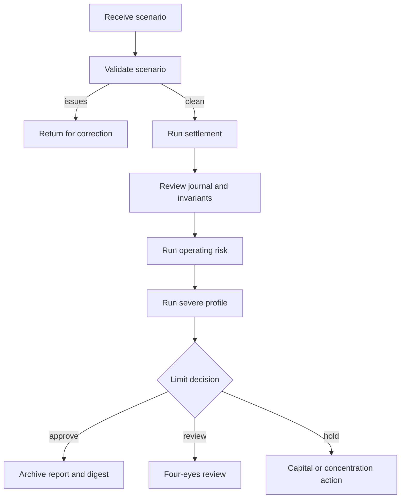

# Operación

## Preparación

```bash
npm ci
npm run build
npm run ci
```

El servicio no necesita una base de datos para ejecutar escenarios. El binario se genera en `bin/marinerdtl` o `bin/marinerdtl.exe`.

## Flujo recomendado



## Comandos

Validación previa:

```bash
bin/marinerdtl validate path/to/scenario.json --json
```

Ejecución con eventos:

```bash
bin/marinerdtl run path/to/scenario.json --events --pretty
```

Stress operativo y severo:

```bash
bin/marinerdtl risk path/to/scenario.json --capital 500000 --json
bin/marinerdtl risk path/to/scenario.json --capital 500000 --severe --json
```

## Observabilidad

El endpoint `/healthz` comprueba disponibilidad del proceso. Los reportes contienen métricas de estado y, opcionalmente, eventos. En una plataforma alojada se recomienda añadir:

- ID de correlación por request;
- logs JSON con versión, escenario y digest;
- métricas de latencia y errores por comando;
- alertas por déficit de capital y decisión `hold`;
- almacenamiento inmutable de reportes aprobados.

## Gestión de incidentes

1. Detener nuevas órdenes para el activo o corredor afectado.
2. Conservar escenario, salida, versión y digest.
3. Reejecutar con el mismo commit y confirmar determinismo.
4. Comparar journal, estado y reporte de riesgo.
5. Delimitar rutas, custodios y operadores relacionados.
6. Corregir mediante un cambio revisado y nuevas pruebas de regresión.
7. Publicar una versión trazable y documentar la resolución.

## Backup y recuperación

El proceso es sin estado persistente, por lo que la plataforma debe conservar entradas y salidas. Para reproducir una operación se necesitan el escenario original, la versión exacta del binario, el perfil de riesgo y el capital disponible usado. El digest confirma la igualdad del informe, pero no sustituye esos artefactos.

## Release

Una versión estable requiere:

- CI verde en la rama candidata y en el pull request;
- merge en `main`;
- rama `production` apuntando al mismo commit;
- tag anotado `v1.0.0` sobre ese commit;
- release `Production 1.0.0`;
- workflow de integridad verde para rama, tag y evento de publicación.
