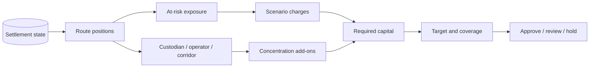

# Riesgo y capital

## Objetivo

El módulo de riesgo convierte el estado de settlement en una visión de cartera. No decide la validez de un comando ni cambia saldos: estima pérdida, concentración y suficiencia de capital para una mesa de operaciones.

## Proyección



Para cada ruta:

```text
unsettled = max(gross - released - cancelled - penalty, 0)
at_risk   = unsettled + frozen + rebate_outstanding
```

La exposición de custodio agrega el remanente de los hitos que tiene asignados. La de operador y corredor agrega `at_risk` por sus respectivas claves.

## Perfiles

| Parámetro                        |  Operativo |     Severo |
| -------------------------------- | ---------: | ---------: |
| Haircut de escrow                |    250 bps |    900 bps |
| Pérdida sobre valor congelado    |  2 000 bps |  6 500 bps |
| Pérdida sobre valor no liquidado |    350 bps |  1 250 bps |
| Reserva de rebate                | 10 000 bps | 10 000 bps |
| Recuperación de penalización     |  6 000 bps |  2 500 bps |
| Cobertura objetivo               | 12 000 bps | 14 500 bps |

Los perfiles se construyen en código y se validan antes del análisis. Cada campo de stress admite de `0` a `10 000 bps`; la cobertura objetivo admite de `10 000` a `30 000 bps`.

## Capital

```text
C_escrow     = escrow_remaining × escrow_haircut
C_frozen     = frozen_value × frozen_loss
C_unsettled  = unsettled_value × unsettled_loss
C_rebate     = rebate_outstanding × rebate_reserve
C_penalty    = penalty_value × (1 - penalty_recovery)
C_required   = C_escrow + C_frozen + C_unsettled + C_rebate
             + custodian_add_on + operator_add_on + corridor_add_on
C_target     = C_required × minimum_coverage
```

Los add-ons solo cargan la porción de concentración que supera `2 500 bps` de la exposición total. Esto evita cobrar por diversificación normal y penaliza dependencias dominantes.

## Cobertura

```text
coverage_bps = available_capital × 10 000 / required_capital
shortfall    = max(target_capital - available_capital, 0)
surplus      = max(available_capital - target_capital, 0)
```

La cobertura se limita a `30 000 bps` en el informe para mantener una escala operativa acotada. Si el capital requerido es cero, la cobertura es cero cuando no hay capital y `30 000 bps` cuando sí lo hay.

## Puerta de límites

- `approve`: no se incumple ningún límite.
- `review`: existe un exceso moderado de concentración.
- `hold`: hay déficit, cobertura insuficiente o un exceso alto.

La puerta es una función pura. El consumidor decide qué workflow de aprobación corresponde; MarinerDTL no ejecuta acciones automáticas a partir de este resultado.

## Ejemplo

Una cartera presenta `10 000 000` no liquidados, `1 000 000` congelados, `200 000` de rebate pendiente y `8 000 000` de escrow. Bajo el perfil operativo:

```text
C_escrow    = 200 000
C_frozen    = 200 000
C_unsettled = 350 000
C_rebate    = 200 000
subtotal    = 950 000 + add-ons
```

Con `1 500 000` de capital y sin add-ons, el objetivo de cobertura sería `1 140 000`, dejando `360 000` de superávit.

## Digest

El informe ordena rutas y concentraciones, elimina el campo `digest`, serializa el resto y calcula SHA-256. El digest permite comparar informes entre procesos y detectar diferencias de parámetros o datos.
